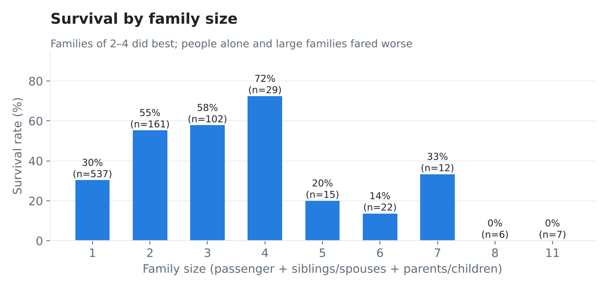

# Titanic Survival Prediction

Predicting which passengers survived the Titanic, for Kaggle's [Titanic - Machine Learning from Disaster](https://www.kaggle.com/competitions/titanic) competition. The project goes from a Random Forest baseline to a family-group model that scores **0.80143** on the leaderboard (335 of 418 test passengers correct).

## Results

| Version | Approach | CV accuracy* | Public score |
|---|---|---|---|
| v1 | Random Forest, 8 features, depth 7, balanced class weights | 81.7% | 0.77511 |
| v2 | Random Forest + Title, age-by-title, HasCabin, depth 5 | 83.0% | 0.77272 |
| **Final** | **Family-group rule (woman-child-group)** | **84.1%** | **0.80143** |
| Reference | Gender rule only (all women survive) | 78.7% | 0.76555 |

\*Repeated stratified cross-validation, 5 folds × 5 repeats, on the 891 training passengers.

The score is plain accuracy over all 418 test passengers, so each passenger is worth about 0.24 percentage points. The gender-rule score is Kaggle's example submission. Full details: [`results/model_comparison.csv`](results/model_comparison.csv) and the [experiments log](docs/experiments_log.md).


## Approach

### 1. Exploration
Survival was driven mostly by **sex** (74% of women survived vs 19% of men), **class** (63% in 1st vs 24% in 3rd) and **family size** (small families survived more often than people travelling alone or in large families).




### 2. Random Forest (v1 and v2)
A scikit-learn `Pipeline` handles imputation and one-hot encoding inside cross-validation. v2 adds:
- **Title** from the name (Mr, Mrs, Miss, Master, Rare), which captures sex, age group and status together
- **Age filled by title**: missing ages get the median age for the passenger's title
- **HasCabin**: whether a cabin number is recorded, a rough proxy for wealth

v2 improved cross-validation from 81.7% to 83.0% but scored one passenger fewer on the leaderboard (0.77511 → 0.77272). Small CV gains don't always carry over to a 418-passenger test set.

### 3. Family-group model (final)
Families tended to live or die together. Starting from the gender rule:
1. Group passengers into families by surname, class, ticket (without its last digit), port and fare.
2. Look only at the **women and boys** ("Master") of each family in the training data.
3. If all of a family's women and boys **died**, predict that family's women in the test set **die** (9 changes).
4. If all of a family's women and boys **survived**, predict that family's boys **survive** (8 changes).

It changes only 17 predictions from the gender rule, and 16 of them turned out correct (+15 net), lifting the score from 0.76555 to 0.80143.

## Lessons learned
- **Watch for data leakage.** An early "tuned" validation score of 89.94% was inflated because the grid search had already seen the validation rows. Retraining on the training split only gave an honest 80.45%.
- **Tune with repeated cross-validation, not one split.** A 179-row validation split is too small to choose settings reliably.
- **Domain structure beats model complexity here.** A few rules about families did better than tuned Random Forests.

## Repository contents

```
notebooks/
  Titanic_Random_Forest_Classification_v1.ipynb   original notebook (0.77511)
  Titanic_Random_Forest_Classification_v2.ipynb   final notebook: RF v2 + family-group model
submissions/
  v1_random_forest.csv                    0.77511
  v2_random_forest.csv                    0.77272
  family_groups.csv                       0.80143
  v2_gradient_boosting_not_submitted.csv  83.3% CV, not submitted
results/
  model_comparison.csv                    every model, its features, CV and Kaggle score
docs/
  experiments_log.md                      every experiment, including the ones that didn't help
images/                                   charts used in this README
data/
  README.md                               how to get the data
```

## How to run
1. Open the competition on Kaggle and accept the rules.
2. Create a notebook from the competition's **Code** tab (this attaches the data), then **File → Import Notebook** with `notebooks/Titanic_Random_Forest_Classification_v2.ipynb`.
3. **Save Version → Save & Run All**. The final section writes `submission.csv`.

The competition data is not included in this repository; see [`data/README.md`](data/README.md).

## Citations
- Will Cukierski. *Titanic - Machine Learning from Disaster.* Kaggle, 2012. https://www.kaggle.com/competitions/titanic
- The family-group (woman-child-group) idea was popularised on Kaggle by Chris Deotte's Titanic notebooks.

## Author
Fritz Jeffry Briones · [github.com/fritzbriones](https://github.com/fritzbriones)
