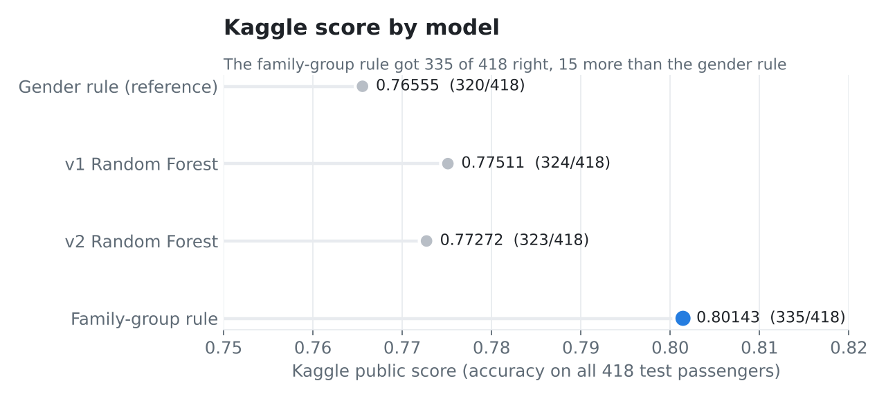
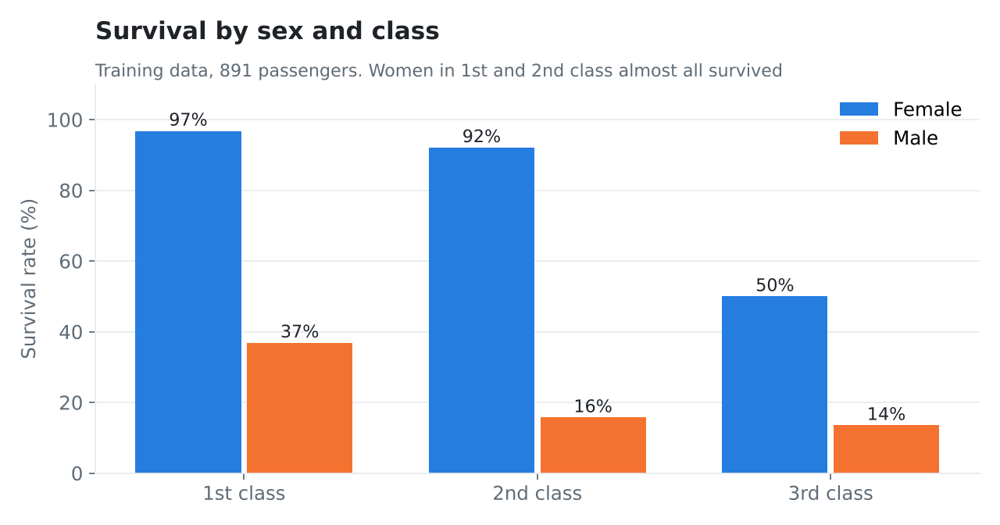
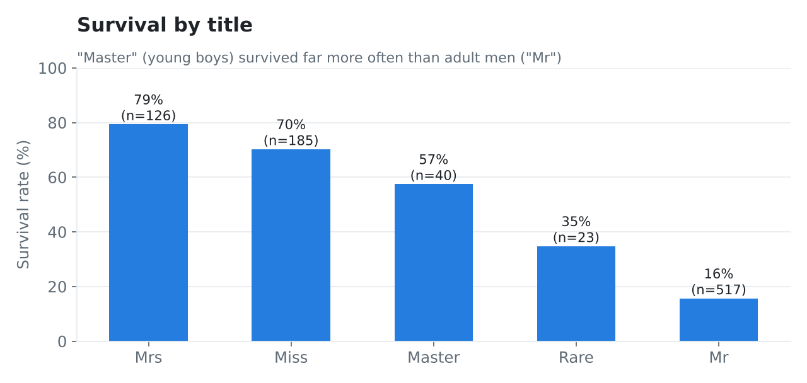

# Titanic Survival Prediction

<p align="center">
  
  <br>
  <sub>RMS <i>Titanic</i> leaving Southampton on her maiden voyage, 10 April 1912. Photo: F.G.O. Stuart, colorized; public domain, via <a href="https://commons.wikimedia.org/wiki/File:Titanic_in_color.png">Wikimedia Commons</a>.</sub>
</p>

Predicting which passengers survived the Titanic, for Kaggle's [Titanic - Machine Learning from Disaster](https://www.kaggle.com/competitions/titanic) competition. The project goes from a Random Forest baseline to a family-group model that scores **0.80143** on the leaderboard (335 of 418 test passengers correct).

## Results

| Version | Approach | CV accuracy* | Public score |
|---|---|---|---|
| v1 | Random Forest, 8 features, depth 7, balanced class weights | 81.7% | 0.77511 |
| v2 | Random Forest + Title, age-by-title, HasCabin, depth 5 | 83.0% | 0.77272 |
| **Final** | **Family-group rule (woman-child-group)** | **84.1%** | **0.80143** |
| Experiment | Blend (RF + XGBoost + LR) + family-rule overrides | 84.5% | 0.78229 |
| Reference | Gender rule only (all women survive) | 78.7% | 0.76555 |

\*Repeated stratified cross-validation, 5 folds × 5 repeats, on the 891 training passengers.

The blend scored highest in cross-validation but lower on Kaggle (see below). Other experiments (XGBoost, group features) have cross-validation results only, because they haven't been submitted; see [Experiments](#4-experiments-xgboost-group-features-and-blending). Every submission is listed in the [leaderboard history](docs/leaderboard.md).

The score is plain accuracy over all 418 test passengers, so each passenger is worth about 0.24 percentage points. The gender-rule score is Kaggle's example submission. Full details: [`results/model_comparison.csv`](results/model_comparison.csv) and the [experiments log](docs/experiments_log.md).



## Key finding
**The family-group rule captures a genuine, reproducible survival pattern in the Titanic data, but its advantage depends on information about related passengers being available.**

- **Real:** 16 of its 17 changed test predictions were correct, and it beat the gender rule on all 25 cross-validation splits (+5.5 points on average).
- **Robust:** 8 different ways of defining a family give nearly identical results and test predictions.
- **Bounded:** on families not seen in training (grouped cross-validation), it adds nothing over the gender rule. It works because 206 of the 418 test passengers have a relative in the training data.

## Limitations
- **Small data.** 891 training and 418 test passengers; one passenger moves the score by 0.24 points, so differences of a few passengers are noise.
- **Depends on known relatives.** The family rule can't help passengers with no relatives in the training data, and wouldn't transfer to a new set of people.
- **Rough family matching.** Families are inferred from surname, ticket, class, port and fare; relatives with different surnames and tickets are missed, and unrelated people could occasionally be grouped.
- **Survival had a random element.** Factors like location on the ship or timing at the lifeboats aren't in the data, which is part of why even strong models usually score around 80–82%.
- **Public leaderboard only.** Scores are from Kaggle's public leaderboard; chasing it with many submissions would risk overfitting to the test set.
- **No crew.** The data covers passengers only, so findings don't describe the crew's survival.

## Approach

### 1. Exploration
Survival was driven mostly by **sex** (74% of women survived vs 19% of men), **class** (63% in 1st vs 24% in 3rd) and **family size** (small families survived more often than people travelling alone or in large families).






### 2. Random Forest (v1 and v2)
A scikit-learn `Pipeline` handles imputation and one-hot encoding inside cross-validation. v2 adds:
- **Title** from the name (Mr, Mrs, Miss, Master, Rare), which captures sex, age group and status together
- **Age filled by title**: missing ages get the median age for the passenger's title
- **HasCabin**: whether a cabin number is recorded, a rough proxy for wealth

v2 improved cross-validation from 81.7% to 83.0% but scored one passenger fewer on the leaderboard (0.77511 → 0.77272). Small CV gains don't always carry over to a 418-passenger test set.

### 3. Family-group model (final)
Families tended to live or die together. Starting from the gender rule:
1. Group passengers into families by surname, class, ticket (without its last digit), port and fare.
2. Look only at the **women and boys** ("Master") of each family in the training data.
3. If all of a family's women and boys **died**, predict that family's women in the test set **die** (9 changes).
4. If all of a family's women and boys **survived**, predict that family's boys **survive** (8 changes).

It changes only 17 predictions from the gender rule, and 16 of them turned out correct (+15 net), lifting the score from 0.76555 to 0.80143.

### 4. Experiments: XGBoost, group features and blending
Notebook: [`Titanic_Experiments_XGBoost_Blending.ipynb`](notebooks/Titanic_Experiments_XGBoost_Blending.ipynb). Every candidate is scored on the same 25 cross-validation splits. Anything learned from survival labels (age medians, family survival rates, the family rules) is rebuilt inside each training fold, so there is no leakage.

| Candidate | CV accuracy | vs family rule (wins / ties / losses over 25 splits) |
|---|---|---|
| Blend (RF + XGBoost + LR probabilities) + family rule | 84.47% | +0.34 pts (13 / 2 / 10). **Kaggle: 0.78229** |
| Blend (RF + XGBoost + LR probabilities) | 84.42% | +0.29 pts (13 / 1 / 11) |
| Random Forest + group features + FamilySurvival | 84.40% | +0.27 pts (13 / 6 / 6) |
| XGBoost + group features + FamilySurvival | 84.29% | +0.16 pts (12 / 2 / 11) |
| **Family-group rule (submitted, 0.80143)** | **84.13%** | — |
| XGBoost + group features | 83.91% | −0.22 pts |
| XGBoost, v2 features | 83.39% | −0.74 pts |

Group features: **FarePerPerson** (fare divided by passengers on the ticket), **TicketGroupSize**, **Sex × Pclass**, and **FamilySurvival** (survival rate of the other women and boys in the passenger's family or ticket group, from the training fold only).

**Finding:** group features helped every model, and FamilySurvival was what brought the machine-learning models level with the family-group rule. But the best gains are about a third of a point, won on only about half of the splits, which is within noise.

**Kaggle confirmed it.** The top cross-validation candidate (blend + family rule) scored **0.78229** (327/418), 8 passengers fewer than the simple family rule. The two files differ on 18 test passengers, and the family rule was right on 13 of them. The simpler model stays the best. Unsubmitted candidates are in `submissions/candidates_not_submitted/`.

### 5. Auditing the family-group model
Notebook: [`Titanic_Family_Group_Audit.ipynb`](notebooks/Titanic_Family_Group_Audit.ipynb). It tests whether the 0.80143 result depends on how a "family" is defined, and how the rule does on families it has never seen.

| Family definition | Stratified CV | Grouped CV (unseen families) | Test changes (of submitted 17) |
|---|---|---|---|
| Gender rule, no families | 78.68% | 78.67% | — |
| **Submitted: surname + class + ticket + port + fare, ticket fallback** | **84.13%** | 78.67% | 17 (17) |
| Trim last digit only, not last character | 84.13% | 78.67% | 17 (17) |
| Without fare, or without fare and port | 84.13% | 78.67% | 17 (17) |
| Submitted, without ticket fallback | 84.15% | 78.67% | 16 (16) |
| Surname + exact ticket | 83.77% | 78.67% | 15 (15) |
| Exact ticket only | 83.73% | 78.67% | 15 (15) |
| Surname + class only (loose) | 83.66% | 78.67% | 17 (16) |

**Findings**
- **The definition barely matters.** Every reasonable definition scores 83.7–84.2%, and the test-set changes are nearly identical, so 0.80143 is not an artifact of one grouping choice.
- **The flagged data quirks are tiny:** 4 tickets end in a letter (all "LINE"), 2 passengers lack a port (a maid and her employer on one ticket), and 1 lacks a fare (an adult man, whom the rule never changes).
- **On unseen families, the rule adds nothing.** Under grouped CV it equals the gender rule, because it can only use relatives already in the training data.
- **What 0.80143 measures:** 206 of the 418 test passengers have a relative in the training data, and the rule exploits that overlap. That's legitimate for this competition, but it wouldn't help for passengers with no known relatives.

## Why 84.1% in cross-validation but 80.1% on Kaggle?
The family-group rule scored 84.1% in cross-validation and 80.1% on Kaggle. A gap like this is expected, for four reasons:

1. **The test set is small.** With 418 passengers, a score of about 80% has a standard error of about ±2 points, so a single test set can easily land 2–4 points away from the long-run accuracy.
2. **The test set looks slightly harder.** Even the one-line gender rule drops from 78.7% in cross-validation to 76.6% on Kaggle, a 2-point gap with no model tuning at all. Part of every model's gap comes from the test passengers themselves.
3. **Fewer family matches.** The family rule only helps when a test passenger has relatives in the training data. In cross-validation, each validation fold has the other 80% of passengers to match against. On Kaggle, the rule found 17 passengers to change out of 418.
4. **Choosing the best of several scores flatters it.** When the highest of many cross-validation results is picked, it's usually a little optimistic.

The useful comparison is between models on the **same** data: the family rule beat the gender rule by 5.5 points in cross-validation and by 3.6 points on Kaggle, so the improvement was real even though both absolute numbers dropped.

## Lessons learned
- **Watch for data leakage.** An early "tuned" validation score of 89.94% was inflated because the grid search had already seen the validation rows. Retraining on the training split only gave an honest 80.45%.
- **Tune with repeated cross-validation, not one split.** A 179-row validation split is too small to choose settings reliably.
- **Domain structure beats model complexity here.** A few rules about families did better than tuned Random Forests, and machine-learning models only caught up once they were given a family-survival feature.
- **Know what your validation measures.** Stratified CV measured performance when relatives are known; grouped CV showed the family rule adds nothing for unseen families.
- **Compare models on the same splits.** Paired results (wins / ties / losses) show whether a small difference is real; a 0.3-point gain won on half the splits is not.

## Repository contents

```
notebooks/
  Titanic_Random_Forest_Classification_v1.ipynb   original notebook (0.77511)
  Titanic_Random_Forest_Classification_v2.ipynb   final notebook: RF v2 + family-group model
  Titanic_Experiments_XGBoost_Blending.ipynb      XGBoost, group features, blending
  Titanic_Family_Group_Audit.ipynb                tests the family definition and grouped CV
submissions/
  v1_random_forest.csv                    0.77511
  v2_random_forest.csv                    0.77272
  family_groups.csv                       0.80143
  blend_plus_family_rule.csv              0.78229
  candidates_not_submitted/               CV results only (XGBoost, blend, gradient boosting)
results/
  model_comparison.csv                    every model, its features, CV and Kaggle score
docs/
  experiments_log.md                      every experiment, including the ones that didn't help
  leaderboard.md                          every Kaggle submission and its score
images/                                   charts used in this README
data/
  README.md                               how to get the data (CSV files are git-ignored)
requirements.txt                          Python packages for running locally
```

## How to run
The notebooks run on **Kaggle** or on **your own computer**. They find the data automatically in either place.

### Option A: on your computer
1. **Clone the repository**
   ```bash
   git clone https://github.com/fritzbriones/titanic-survival-prediction.git
   cd titanic-survival-prediction
   ```
2. **Install the packages** (Python 3.9+)
   ```bash
   pip install -r requirements.txt
   ```
3. **Download the data.** Sign in to Kaggle, join the [Titanic competition](https://www.kaggle.com/competitions/titanic) to accept the rules, and download the files from its [Data page](https://www.kaggle.com/competitions/titanic/data). Put these in the repo's `data/` folder:
   - `train.csv`
   - `test.csv`
   - `gender_submission.csv`

   The data folder ignores CSV files, so the competition data won't be committed by accident.
4. **Start Jupyter** from the project folder:
   ```bash
   jupyter notebook
   ```
5. **Open a notebook** in `notebooks/`:
   - `Titanic_Random_Forest_Classification_v2.ipynb`: exploration, Random Forest models and the family-group rule (writes `submission.csv`, which scores 0.80143)
   - `Titanic_Experiments_XGBoost_Blending.ipynb`: XGBoost, group features and blending
6. **Run it:** **Kernel → Restart & Run All**. Output files are saved next to the notebook.

### Option B: on Kaggle
1. Open the [Titanic competition](https://www.kaggle.com/competitions/titanic), sign in and click **Join Competition**.
2. **Attach the data**, either way:
   - from the competition's **Code** tab, click **New Notebook** (the data is attached automatically); or
   - in any notebook, click **+ Add Input**, search for **Titanic - Machine Learning from Disaster**, and add the **competition** (not a dataset copy).
3. **Check it's attached:** the first code cell should print `train.csv`, `test.csv` and `gender_submission.csv` under `/kaggle/input/`.
4. **Import the notebook:** **File → Import Notebook**, then upload `notebooks/Titanic_Random_Forest_Classification_v2.ipynb`.
5. **Save Version → Save & Run All (Commit).**
6. Open the saved version's **Output** tab and submit `submission.csv` (expected score 0.80143).

If a notebook says *"train.csv not found"*, the data isn't in `data/` (local) or isn't attached (Kaggle).

### Explore the results
- [`results/model_comparison.csv`](results/model_comparison.csv): every model, its features, CV and Kaggle score
- [`docs/leaderboard.md`](docs/leaderboard.md): every Kaggle submission
- [`docs/experiments_log.md`](docs/experiments_log.md): every experiment, including the ones that didn't help
- [`images/`](images/): the charts in this README

## Citations
- Will Cukierski. *Titanic - Machine Learning from Disaster.* Kaggle, 2012. https://www.kaggle.com/competitions/titanic
- The family-group (woman-child-group) idea was popularised on Kaggle by Chris Deotte's Titanic notebooks.

## Author
Fritz Jeffry Briones · [github.com/fritzbriones](https://github.com/fritzbriones)
